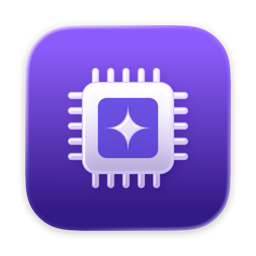

<div align="center">



# Arin

**Reclaim disk space on your developer Mac, with your coding agent as a second opinion.**

[](https://github.com/sozercan/arin/releases/latest)
[](https://github.com/sozercan/arin/actions/workflows/ci.yml)


</div>

Arin is a native macOS app that finds space that's safe to reclaim: package caches, build output, stale simulators, merged worktrees, idle Docker data, old models. Rules decide what each item is. Claude Code or Codex double-checks anything the rules can't settle. Nothing is removed until you tick it.

## Install

```bash
brew install --cask sozercan/repo/arin
```

This installs **Arin.app** and links the `arin` command-line tool. To update later:

```bash
brew upgrade --cask arin
```

<details>
<summary>Install without Homebrew</summary>

Download the DMG from the [latest release](https://github.com/sozercan/arin/releases/latest) and drag Arin to Applications. Releases aren't notarized yet, so macOS blocks the first launch: open **System Settings → Privacy & Security** and click **Open Anyway**. Homebrew handles this for you.

</details>

**Requirements:** macOS 26 or later. For agent reviews, install [Claude Code](https://docs.claude.com/en/docs/claude-code) or [Codex](https://github.com/openai/codex). Arin works without either; it just skips the second opinion.

## How it works

1. **Scan.** Arin looks where developer Macs hide space and sorts every item into a cleanup level, with a reason.
2. **Review.** Items the rules can't settle go to your coding agent in a read-only mode. It returns *safe*, *review*, or *keep*, with a reason for each.
3. **Clean.** You pick. Right before each item, Arin re-checks running apps and open files, refuses protected locations, and uses the tool's own cleanup command where one works. Then it reports how much free space actually changed.

## What it finds

| Where | What |
|---|---|
| **Package caches** | Go, npm, uv, pnpm, bun, Homebrew |
| **Xcode** | DerivedData, simulators and runtimes, archives |
| **Project build output** | `node_modules`, `.build`, venvs, Cargo `target`, `.next`, Gradle `build`, `.dart_tool`, Zig caches, `.terraform`, and any folder tagged with `CACHEDIR.TAG` |
| **Git worktrees** | Worktrees whose branch was merged, including squash merges |
| **Containers & VMs** | Docker build cache and orphaned volumes, Lima and Colima downloads |
| **Local AI models** | Ollama and LM Studio |
| **Tool versions** | Old Codex and Claude releases, unused mise versions, extra Rust toolchains |
| **System** | Stale temp build folders, Time Machine local snapshots |
| **Everything else** | A size overview of your home folder surfaces other large folders (agent output, logs, app data) under *Unclassified* |

## Cleanup levels

| Level | Includes |
|---|---|
| **Quick** | Caches that refill on their own: package caches, idle DerivedData, unavailable simulators, stale temp folders, old tool versions |
| **Standard** | Adds build output (`node_modules`, `.build`, venvs, `bin/`), merged worktrees, Docker build cache, app caches |
| **Deep** | Adds simulator data, old runtimes, extra toolchains, archives, local AI models, Time Machine local snapshots, unrecognized app data |

Only items marked **Safe** at or below the chosen level are pre-selected. Build output in a project you changed in the last 7 days is listed but not pre-selected.

## Built to be careful

- **The agent can only advise.** It can't run commands that change anything or add actions; Arin's rules and guardrails decide what can be done. Agent verdicts can make an item more cautious, and less cautious only for items no rule recognizes.
- **Private folders stay private.** Claude Code is denied reads of credentials and personal folders (`~/.ssh`, `~/.aws`, keychains, cookies, Mail, Messages, Documents). Codex's read-only sandbox blocks writes and network access but not reads, so for Codex that rule lives only in the prompt.
- **Always Keep.** Right-click an item and choose *Always Keep*. Kept items are never pre-selected, never sent for review, and refused by the cleaner, even when reached through another path or a symlink. If the keep list can't be read, Arin cleans nothing.
- **Honest numbers.** Folder sizes overstate what deleting frees because of APFS clones and snapshots. Arin measures the real change in free space and explains any gap.
- **Put Back.** Anything moved to the Trash can be restored from History.

## In the app

- **Space map.** A treemap of everything the scan found, by category. Click a tile to select it.
- **History.** Each scan and cleanup: what grew back, free space over time, and what each cleanup freed.
- **Menu bar gauge.** Free space at a glance, with an alert when it drops below your threshold.
- **Auto mode.** Opt in, and when free space runs low Arin clears only caches that refill on their own. Turn on *Open at login* to keep it running after a restart.

Reviews run automatically after each scan; you can turn them off in Settings. They default to a light setup (Sonnet at low effort for Claude Code, your configured model at low effort for Codex), which you can change there too. With a Claude plan, reviews count toward your plan's usage limits.

## Command line

The same engine runs headless. Everything is read-only or a dry run until you pass `--yes`.

```bash
arin scan --level standard                 # find candidates
arin review --agent claude                 # scan, then ask your agent
arin clean --level quick                   # dry run: show what would go
arin clean --level quick --yes             # clean the pre-selected items
arin clean --ids 'go.build-cache:go.build-cache' --yes
arin plan --level quick --out plan.json    # save what clean would pick
arin clean --plan plan.json --yes          # rescan, then run only unchanged items
arin keep 'docker.volume:pgdata'           # never clean this (--remove undoes)
arin history                               # past cleanups and what grew back
```

A saved plan is re-checked when it runs: any item that's gone, changed (a worktree with a new commit, a new snapshot, a moved npm cache), became more cautious, or was kept since is refused. Run `arin --help` for every option.

### From your agent

`arin skill` prints a skill that teaches Claude Code, Codex, or another agent to scan with `--json`, summarize, and clean only the IDs you approve:

```bash
mkdir -p ~/.claude/skills/arin && arin skill > ~/.claude/skills/arin/SKILL.md
```

The agent gets nothing beyond the CLI: actions still come from Arin's rules, and the cleaner re-checks everything.

## Uninstall

```bash
brew uninstall --cask --zap arin
```

`--zap` also removes Arin's preferences. History and the keep list live in `~/Library/Application Support/com.sertacozercan.Arin`.

## Contributing

Build instructions, project layout, and how rules are added are in [CONTRIBUTING.md](CONTRIBUTING.md). [docs/learnings.md](docs/learnings.md) explains why each rule and guardrail exists.
